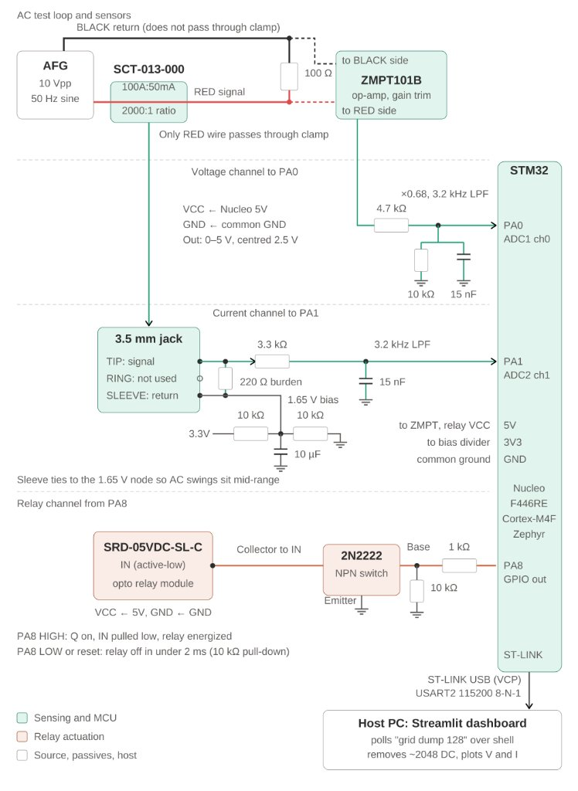

# Smart Grid Edge Monitor

> **Synchronous Micro-PMU, Sub-2ms Protection & Physics-Informed NILM Engine**  
> **Target:** STM32 Nucleo-F446RE (ARM Cortex-M4 @ 180 MHz) · Zephyr RTOS · Python Streamlit Dashboard

---

An edge smart grid monitor combining synchronous dual-channel mains acquisition, hardware circuit protection, and harmonic Non-Intrusive Load Monitoring (NILM) into a single microcontroller. Operates on both **230 V AC mains** and **low-voltage lab bench supplies (0–20 V AC, 50 Hz)**.

---

## Key Specifications

| Parameter | Specification | Notes |
| :--- | :--- | :--- |
| **Microcontroller** | STM32 Nucleo-F446RE | ARM Cortex-M4 with FPU @ 180 MHz, 512 KB Flash, 128 KB SRAM |
| **Operating System** | Zephyr RTOS v4.2.0 | Preemptive multi-threading with `zbus` inter-thread messaging |
| **Grid Frequency** | **50.0 Hz** | Synchronous timing geometry (204.8 samples/cycle) |
| **Operating Voltages** | **0–20 V AC** (Bench) / **230 V AC** (Mains) | Scaled via calibration constant `k_v` stored in NVS flash |
| **Acquisition Engine** | 10,240 Hz Dual Synchronous ADC | Dual ADC1+ADC2 triggered by TIM2 TRGO, DMA2 Stream 0 circular mode |
| **Anti-Noise Filter** | Real-Time Balanced IIR Low-Pass | Identical $f_c \approx 540\text{ Hz}$ filter on V & I preserving relative phase angle ($\Delta\phi$) |
| **Fault Protection** | Instantaneous Trip in < 1.56 ms | Evaluated every 16-sample DMA block; hardware cutoff via relay |
| **FFT Engine** | 2048-point CMSIS-DSP Real FFT | Extracts fundamental, $h_3, h_5, h_7$, THD, and phasor phase angle |
| **Load Classification** | Deterministic Physics State Machine | Classifies Resistive, SMPS, Motor / Inductive, and Standby / No Load |
| **Transient Filter** | 3-Cycle Temporal Filter | Rejects contact-bounce EMI glitches before accepting state changes |

---

## Hardware Interfacing & Pinout

<p align="center">
  
</p>

### Pin Connections

| Module Pin | STM32 Nucleo Pin | Signal / Function | Notes |
| :--- | :--- | :--- | :--- |
| **ZMPT101B VCC** | **5V** (CN6) | Module Power | Requires 5V for linear op-amp operation |
| **ZMPT101B GND** | **GND** | Common Ground | Must share ground with STM32 |
| **ZMPT101B OUT** | **PA0** (ADC1 IN0) | Voltage Channel | Connect through series resistor + 100 nF LP filter to GND |
| **SCT-013 Tip** | **PA1** (ADC2 IN1) | Current Signal | Across 220 Ω burden resistor, through 3.3 kΩ to PA1 |
| **SCT-013 Sleeve** | **1.65 V Bias Node** | DC Virtual Ground | Midpoint of 10 kΩ / 10 kΩ divider from 3.3 V (Do NOT connect directly to GND) |
| **Relay IN** | **PA8** (D7) | Relay Trip Control | Direct active-low control (`GPIO_ACTIVE_LOW` in device tree) |
| **Relay VCC** | **5V** (CN6) | Relay Coil Power | 5V supply |
| **Relay GND** | **GND** | Common Ground | Shared ground |
| **ST-LINK USB** | **USART2 (PA2/PA3)** | Host Telemetry | 115200 baud, 8-N-1 Virtual COM Port |

> [!IMPORTANT]
> **CT Clamp Direction:** Clamp the SCT-013 current transformer over the **Phase/Live wire only**. Clamping both Live and Neutral simultaneously cancels the magnetic fields, resulting in zero current reading.

---

## Operating Voltage Modes: Bench (0–20 V) vs Mains (230 V)

The firmware natively supports both lab-bench safety testing and full mains deployment:

1. **Lab Bench Mode (0–20 V AC, 50 Hz):**
   - Supply a 50 Hz sine wave from a function generator (set to **High-Z**, $1\text{–}2\text{ V}_\text{pp}$) or a low-voltage AC transformer to the ZMPT101B primary.
   - In the Streamlit dashboard sidebar under **Bench Calibration (0-15V)**:
     - Enter your actual bench voltage (e.g. `12.0`) and click **Calibrate Voltage**.
     - Click **Set Low-Voltage Thresholds (0.05W)** to configure `t_event_w = 0.05 W` and `t_min_irms = 0.005 A` for sensitive bench loads.
2. **Mains Mode (230 V AC, 50 Hz):**
   - Connect to mains via appropriate safety isolation.
   - Enter `230.0` and click **Calibrate Voltage**. Default full-scale thresholds (`t_event_w = 2.0 W`, `t_min_irms = 0.080 A`) apply.

---

## Multi-Threaded RTOS Architecture

The firmware decouples critical protection timing from signal processing using preemptive Zephyr threads:

```
+-------------------------------------------------------------------------+
|                  TIM2 Hardware Sample Clock (10,240 Hz)                 |
+-------------------------------------------------------------------------+
                                    | (Hardware Trigger)
                                    v
+-------------------------------------------------------------------------+
|        Simultaneous Dual ADC (ADC1: PA0 Voltage, ADC2: PA1 Current)      |
+-------------------------------------------------------------------------+
                                    | (Circular DMA)
                                    v
+-------------------------------------------------------------------------+
| Priority 0: Protection Thread (protect.c) - Every 16 samples (1.56 ms)   |
| - Instantaneous overcurrent check (< 1.56 ms trip)                      |
| - Dual-channel balanced IIR filter (fc ≈ 540 Hz)                        |
| - Zero-crossing tracking with hysteresis -> publishes cycle_metrics     |
+-------------------------------------------------------------------------+
                                    | (zbus message)
                                    v
+-------------------------------------------------------------------------+
| Priority 2: DSP & NILM Thread (dsp_task.c)                              |
| - 2048-point CMSIS-DSP Real FFT across 10 complete 50 Hz cycles         |
| - Harmonic extraction (fundamental, h3, h5, h7, THD)                    |
| - Phasor phase angle calculation (V vs I)                               |
| - Deterministic physics-informed state machine classification           |
| - 3-cycle temporal confidence debouncing                                |
+-------------------------------------------------------------------------+
                                    |
                                    v
+-------------------------------------------------------------------------+
| Priority 5: Telemetry & Shell (telemetry.c, grid_shell.c)               |
| - NVS Flash non-volatile fault logging                                  |
| - Interactive UART shell at 115200 baud                                 |
| - Live measurement streaming to Streamlit host UI                       |
+-------------------------------------------------------------------------+
```

---

## Deterministic Physics-Informed NILM Engine

Rather than relying on brittle, computationally heavy neural networks that require large training datasets, this monitor implements a **deterministic physics-informed state machine** based on fundamental circuit laws:

```
                    +---------------------------+
                    | New Cycle Metrics Arrived |
                    +---------------------------+
                                  |
                        [I_rms < t_min_irms?]
                               /        \
                            Yes          No
                            /              \
            +-------------------+    +-----------------------------+
            | LOAD_NONE         |    | Steady-State Settling Check |
            | (Standby/No Load) |    +-----------------------------+
            +-------------------+                  |
                                         [Is State Steady?]
                                           /            \
                                         No             Yes
                                         /                \
                         +---------------+        +----------------+
                         | Keep Previous |        | Run 2048-pt    |
                         | Accepted Class|        | CMSIS-DSP FFT  |
                         +---------------+        +----------------+
                                                           |
                                 +-------------------------+-------------------------+
                                 |                                                   |
                     [THD >= 20% & h3 >= 10%?]                                [THD < 20%?]
                                 |                                                   |
                                Yes                                                 Yes
                                 |                                                   |
                     +-----------------------+                           [|Power Factor| >= 0.90?]
                     | LOAD_SMPS             |                                   /         \
                     | (Laptop/Phone Charger,|                                 Yes          No
                     | LED Driver, PC Supply)|                                 /              \
                     +-----------------------+                  +------------------+   +-------------------+
                                                                | LOAD_RESISTIVE   |   | LOAD_MOTOR        |
                                                                | (Heaters, Bulbs, |   | (Fans, Pumps,     |
                                                                | Kettles, Irons)  |   | Compressors)      |
                                                                +------------------+   +-------------------+
```

### Feature Boundaries (Dimensionless & Normalized)

- **Resistive (`LOAD_RESISTIVE`):** Linear Ohm's law impedance. Voltage and current are in phase.  
  `THD < 20%` AND `|PF| >= 0.90`.
- **Switch-Mode Power Supply (`LOAD_SMPS`):** Input bridge rectifier conducts only near voltage peaks, generating prominent odd harmonics.  
  `THD >= 20%` AND `h3 >= 10%`.
- **Motor / Inductive (`LOAD_MOTOR`):** Magnetic core inductance causes fundamental current to lag voltage; startup surge creates inrush.  
  `|PF| < 0.90` OR `Inrush Ratio >= 1.6x`.
- **No Load / Standby (`LOAD_NONE`):** Current below threshold for $\ge 5$ consecutive cycles.  
  `I_rms < t_min_irms`.

---

## Quickstart Guide

### 1. Run Unit Tests on PC (No Hardware Needed)

Run the mathematical verification suite testing cycle integration, CMSIS FFT scaling, and NILM classification:

```bash
cd grid_monitor/tests/host
make test
```
*Expected output:* `45 checks passed, 0 failed.`

---

### 2. Launch the Streamlit Dashboard

```bash
cd Grid_Monitor_Dashboard
python3 -m venv .venv
source .venv/bin/activate
pip install -r requirements.txt
streamlit run app.py
```

Open `http://localhost:8501` in your browser, select your Nucleo port (e.g. `/dev/cu.usbmodem1403` on macOS or `COMx` on Windows), and click **Connect**.

---

### 3. Build & Flash Firmware (STM32 Nucleo-F446RE)

From the project root:

```bash
source env_firmware.sh
west build -b nucleo_f446re grid_monitor
west flash --runner openocd
```

*(Note: Click "Disconnect" in the Streamlit UI before flashing so the ST-LINK USB interface is free).*

---

## Interactive Serial Console Commands

Connect to the board over UART (115200 8-N-1) using PuTTY, `screen`, or through the dashboard:

```bash
grid status              # Live power, frequency, relay status, and classified load
grid feat                # Harmonic extraction: fundamental, h3, h5, h7, THD, phase angle
grid dump 512            # Captures 512 raw synchronous ADC samples for waveform analysis
grid cal v 12.0          # Calibrates voltage scaling factor to 12.0 V RMS (or 230.0 V)
grid cal i 0.50          # Calibrates current scaling factor against a reference instrument
grid cfg set t_event_w 0.05 # Sets power event threshold to 50 mW for bench loads
grid cfg save            # Persists updated calibration and configuration to NVS flash
grid on | off            # Manual relay energize / de-energize control
grid reset               # Clears latched hardware trip and restores power
grid fault_log           # Inspects persistent flash log of previous overcurrent trip events
```

---

## License

MIT License. Open-source for academic, educational, and research use.
